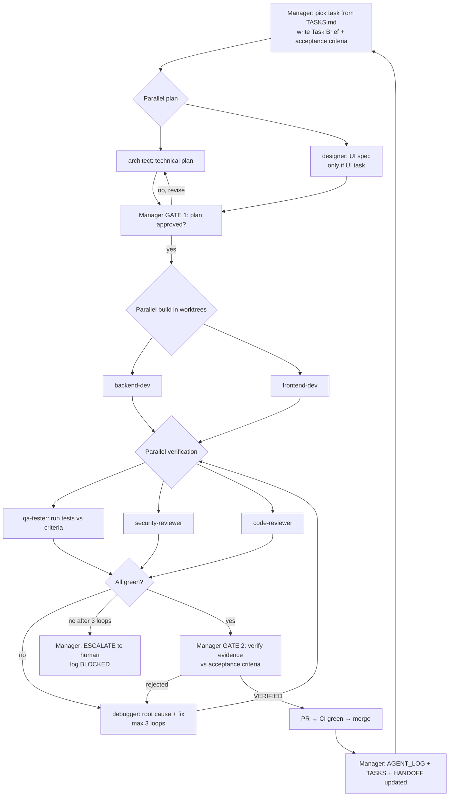

# Agent Playbook: Party A's Multi-Agent "Software Company"

This is **for Party A only.** It runs a small AI software company inside Claude Code: a **Manager** (your main session) directs specialist subagents (architect, designer, developers, QA, debugger, security, reviewer, release). They run in parallel where they can. **Nothing counts as done until the Manager has verified it and logged it.**

The agent definitions are in `.claude/agents/*.md`, and Claude Code loads them automatically when you open the repo.

---

## 1. The org chart

| Agent | File | Role in a real company | Can edit code? | Runs in parallel? |
|---|---|---|---|---|
| **Manager** (you + main Claude session) | `CLAUDE.md` §Manager | Eng manager / PM. Picks tasks, writes briefs, dispatches, **verifies**, merges, keeps the logs. | Only `logs/` and `docs/` | n/a |
| `architect` | `.claude/agents/architect.md` | Tech lead. Plans files, schema and API **before** code. | ❌ read-only | ✅ with designer |
| `designer` | `.claude/agents/designer.md` | UI/UX. Screen spec, states, copy, a11y. Reads Figma. | Specs only | ✅ with architect |
| `backend-dev` | `.claude/agents/backend-dev.md` | Backend engineer. SQL, RLS, RPC, edge functions. | ✅ (own worktree) | ✅ with frontend-dev |
| `frontend-dev` | `.claude/agents/frontend-dev.md` | Frontend engineer. Expo screens and components (B-lane in solo mode). | ✅ (own worktree) | ✅ with backend-dev |
| `qa-tester` | `.claude/agents/qa-tester.md` | QA. Writes and runs tests against the acceptance criteria. | Tests only | ✅ with security |
| `debugger` | `.claude/agents/debugger.md` | SRE / debugger. Reproduces, finds the root cause, makes the minimal fix. | ✅ | ❌ (serial) |
| `security-reviewer` | `.claude/agents/security-reviewer.md` | AppSec. RLS escape attempts, secrets, auth. | ❌ read + run | ✅ with QA |
| `code-reviewer` | `.claude/agents/code-reviewer.md` | Senior reviewer. Correctness, simplicity, conventions. | ❌ | ✅ with QA |
| `release-manager` | `.claude/agents/release-manager.md` | DevOps. CI, deploys, tags, runbook. **Party B owns this lane; Party A uses the agent in solo mode.** | CI/config | ❌ |

> Claude Code subagents can't spawn other subagents, so **the main session is always the Manager**. You talk to the Manager. The Manager talks to the agents.

---

## 2. The loop (per task)



**Gate rules**
- **Gate 1 (plan):** the plan names the files, the migrations (with GRANT + RLS), the tests to write, and the risks. If it touches a LOCKED item, an ADR is required first.
- **Gate 2 (verify):** the Manager re-runs the test command and reads the actual output. It doesn't trust an agent's "tests pass". Every acceptance criterion maps to evidence (a test name, a screenshot, a SQL output).
- **3-strike rule:** if the debugger fails 3 times, stop, mark the task `BLOCKED` with the findings, and bring in a human (Party A).

---

## 3. Logging protocol (non-negotiable)

Every agent ends its run by writing an entry to `logs/AGENT_LOG.md` (append-only) and returning a **Verification Request** to the Manager.

### 3.1 `logs/AGENT_LOG.md` entry format
```markdown
### [2026-10-10 14:32] backend-dev · T05 · register_for_event RPC
- **Status:** DONE | PARTIAL | FAILED | BLOCKED
- **Did:** created migration 0004_registrations.sql (table, UNIQUE, GRANT, RLS), RPC
- **Files:** supabase/migrations/0004_registrations.sql, supabase/tests/0004.sql
- **Evidence:** `supabase test db` → 12 passed, 0 failed (output pasted below / in PR)
- **Left off at:** n/a
- **Next:** frontend-dev to wire useRegister() hook
- **Verification requested from Manager:** yes
- **Manager verdict:** VERIFIED ✅ (2026-10-10 14:50) | REJECTED ❌ reason…
```

### 3.2 Other log files
| File | Purpose | Who writes it |
|---|---|---|
| `logs/TASKS.md` | Kanban: Backlog → Ready → In progress → Review → **Verified** → Done | Manager |
| `logs/HANDOFF.md` | **Resume point.** Overwritten (not appended) at every stop. | Manager (any agent if tokens are running out) |
| `logs/DECISIONS.md` | ADRs: context → decision → consequences | Manager / architect |
| `logs/AGENT_LOG.md` | Append-only history of every agent run | Every agent |

### 3.3 When tokens or context run out
1. Any agent that sees its context getting long **stops coding** and writes `HANDOFF.md`: the task, the exact step, the files changed but not committed, the next command to run, and open questions.
2. It commits work-in-progress to its branch as `wip(T05): …` (never to main).
3. In a new session, the Manager runs the shared kick-off message (`06_SYSTEM_PROMPTS.md`) and resumes from `HANDOFF.md`.
4. Optional automation: add a Claude Code **`PreCompact` hook** and a **`Stop` hook** that remind the agent to update `HANDOFF.md`. Use `/update-config` to set them up on Day 1.

---

## 4. How to actually run it (Party A)

### One-time setup (Day 0)
```bash
git clone https://github.com/manav-Mnv/puma.git
```
```bash
cd puma
```
```bash
claude
```
In Claude Code, run `/agents` to confirm the 9 agents are listed.

### Per task (copy this to the Manager)
```text
Act as Manager per CLAUDE.md. Task T05 (browse + register).
1) Write the Task Brief with acceptance criteria into logs/TASKS.md.
2) In parallel: use the architect agent for the plan and the designer agent for the UI spec.
3) Show me Gate 1. After my OK: run backend-dev and frontend-dev in parallel, each in its own worktree.
4) Then in parallel: qa-tester, security-reviewer, code-reviewer.
5) Loop debugger on failures (max 3). Verify the evidence yourself (Gate 2).
6) Open a PR, log everything, update HANDOFF.md.
```

### Parallel work: what runs together safely
| Together ✅ | Never together ❌ |
|---|---|
| architect + designer | two agents editing the same file |
| backend-dev (worktree A) + frontend-dev (worktree B, against mocks) | debugger + any builder on the same branch |
| qa-tester + security-reviewer + code-reviewer (all read the same diff) | two migrations with the same number |
| Two *different* tasks in different worktrees (e.g. T06 UI + T08 SQL) | release-manager while something is merging |

### Cost and token hygiene
- Give each agent a **narrow brief** (task ID + the files to read). Don't paste whole docs.
- The architect, reviewers and security agents are read-only, so a cheaper or faster model is fine for them. Builders and the debugger get the strongest model.
- Run `/code-review` on the PR as a final independent check before merging.
- Use `/loop` only for the long fallback, never to poll every minute.

---

## 5. Example: Day 4 (T06 + T07) in practice
1. Manager writes briefs for T06 (ticket QR) and T07 (Mode A scan).
2. `architect` returns the `check_in_by_ticket` RPC design and the event-window rule. `designer` returns the scanner states (idle / ✅ name+photo / ⚠️ already / ❌ wrong event / offline).
3. Gate 1 OK → `backend-dev` (RPC + tests) ∥ `frontend-dev` (Tickets screen + scanner against the mock).
4. `qa-tester` writes RLS tests ("a student can't call check-in for another event"), a unit test for the scanner state machine, and a Playwright scan simulation. `security-reviewer` tries to check in someone else's ticket as a student.
5. A failure (a race returns an error instead of "already") goes to the `debugger`, which switches to `ON CONFLICT DO NOTHING` + a select → green.
6. Manager re-runs `npm test` + `supabase test db`, sees the output, marks VERIFIED, merges the PR, and updates HANDOFF.

---

## 6. If Party B is active
- Party B runs their own assistant with the Party B system prompt and **only** the B-lane tasks.
- The Manager treats Party B's PRs exactly like `frontend-dev` output: same QA, security and review gates.
- Each morning, the Manager checks the B-lane in `TASKS.md`. A missed checkpoint (Day 2 / Day 5) means the solo cut-list is applied and logged as an ADR.
